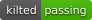
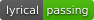

# duatic_cartographer

[](https://github.com/Duatic/duatic_cartographer/actions/workflows/ci.yml)
[](https://github.com/Duatic/duatic_cartographer/actions/workflows/ci.yml)
[](https://github.com/Duatic/duatic_cartographer/actions/workflows/ci.yml)
[](https://github.com/Duatic/duatic_cartographer/actions/workflows/ci.yml)

This repository is the Duatic fork of [Cartographer](https://github.com/cartographer-project/cartographer), a system for real-time simultaneous localization and mapping (SLAM) in 2D and 3D. It is based on the ROS 2 port in [ros2/cartographer](https://github.com/ros2/cartographer) and is used together with [duatic_cartographer_ros](https://github.com/Duatic/duatic_cartographer_ros).

# Changes to upstream

- `TRAJECTORY_BUILDER_2D.min_intensity` drops 2D rangefinder points with a lower intensity, such as beams reflected off glass. The default of `0.` keeps every point.
- In 2D, free-space rays are cast from each point's own origin, when the range data carries per-point origins, instead of from the single scan origin.

# Citation

If you use Cartographer in your research, please cite the original publication:

```bibtex
@inproceedings{hess2016realtime,
  author    = {Hess, Wolfgang and Kohler, Damon and Rapp, Holger and Andor, Daniel},
  title     = {Real-Time Loop Closure in {2D} {LIDAR} {SLAM}},
  booktitle = {2016 IEEE International Conference on Robotics and Automation (ICRA)},
  year      = {2016},
  pages     = {1271--1278}
}
```

# License

The contents are licensed under the Apache-2.0 [license](LICENSE). The copyright holders are listed in [AUTHORS](AUTHORS).

# Usage

Clone this repository into the `src` folder of a ROS 2 workspace and build it with `colcon build`. Its dependencies are resolved with `rosdep install --from-paths src --ignore-src`.

For configuration and tuning please refer to the upstream [Cartographer documentation](https://google-cartographer.readthedocs.io). The options added by this fork are documented in [docs/source/configuration.rst](docs/source/configuration.rst).

# Contributing

Please see the [Contributing guide](./CONTRIBUTING.md)
